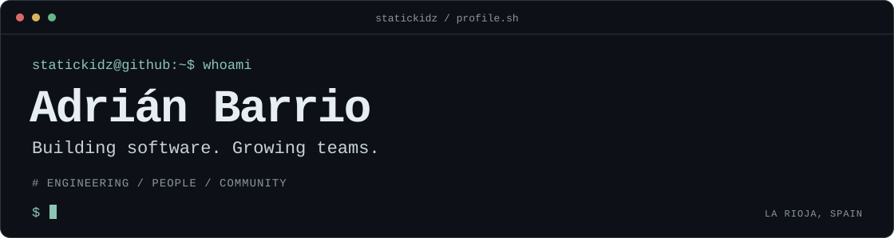

<!-- Header source: scripts/generate-headers.ps1. Usage: scripts/README.md. -->

[Website](https://statickidz.com/) &nbsp;·&nbsp; [LinkedIn](https://www.linkedin.com/in/adrianbarrio/) &nbsp;·&nbsp; [Cloud Native Rioja](https://cloudnativerioja.com/) &nbsp;·&nbsp; [AAIF](https://agenticrioja.com/) &nbsp;·&nbsp; [Repositories](https://github.com/statickidz?tab=repositories)

## `$ cat about.md`

I'm **Adrián**, a software engineer based in **La Rioja, Spain**, with [15+ years of experience in software development and people management](https://www.linkedin.com/in/adrianbarrio/).

My background spans frontend and mobile development, **engineering management**, and site reliability. I enjoy building useful software, helping teams work well together, and sharing what I learn.

Currently a **Senior Site Reliability Engineer at [Oracle](https://www.oracle.com/)**, keeping **Oracle Health's cloud infrastructure** reliable and scalable.

## `$ cat toolkit.md`

| Area | Tools & experience |
| :--- | :--- |
| **Languages** | `JavaScript` · `Go` · `PHP` |
| **Web & mobile** | `Node.js` · `Astro` · `React Native` · `Electron` |
| **Infrastructure** | `Kubernetes` · `Docker` · `Terraform` · `OCI` |
| **Leadership** | Engineering management · Team leadership · Community organizing |

## `$ ls ~/projects`

| Repository | What it does |
| :--- | :--- |
| **[`stock-predictor`](https://github.com/statickidz/stock-predictor)** | AI forecasts for stocks, ETFs, and crypto with Kronos, running in your browser through WebGPU or WebAssembly. |
| **[`avd-manager-ui`](https://github.com/statickidz/avd-manager-ui)** | An Electron and React desktop app to launch Android Studio emulators without opening the IDE. |
| **[`dokploy-oci-free`](https://github.com/statickidz/dokploy-oci-free)** | Terraform configuration to deploy Dokploy and worker nodes on OCI Free Tier. |
| **[`coolify-oci-free`](https://github.com/statickidz/coolify-oci-free)** | Terraform setup to self-host Coolify and worker nodes on OCI Free Tier. |
| **[`wallet-tracker`](https://github.com/statickidz/wallet-tracker)** | Track crypto wallets and get notified when a new transaction is being processed. |
| **[`php-google-translate-free`](https://github.com/statickidz/php-google-translate-free)** | A lightweight PHP library for translating text with Google Translate. |

## `$ cat community.md`

- **Co-organizer at [Cloud Native Rioja](https://cloudnativerioja.com/)** — Bringing people together around Kubernetes and the cloud native ecosystem.
- **Community Organizer for [Agentic AI Foundation (AAIF)](https://agenticrioja.com/) in Logroño, La Rioja** — Helping grow the local open-source agentic AI community through technical talks, live demos, and shared engineering experience.

## `$ cat offline.txt`

Cycling through La Rioja, playing indie games, and getting drawn into a good story.

## `$ ./connect`

Let's talk software engineering, team leadership, or community events. **[Find me on LinkedIn](https://www.linkedin.com/in/adrianbarrio/)** or visit **[statickidz.com](https://statickidz.com/)**.
